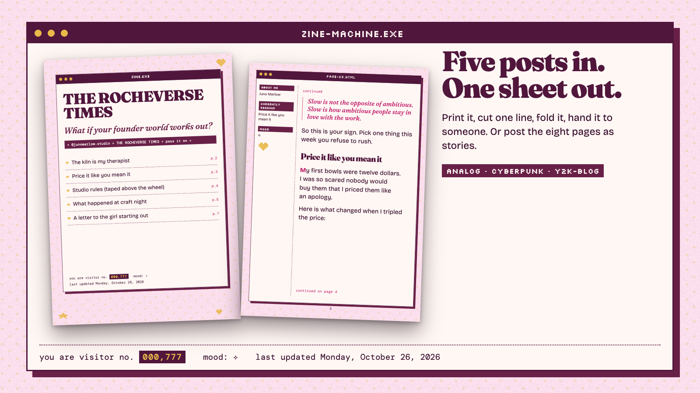
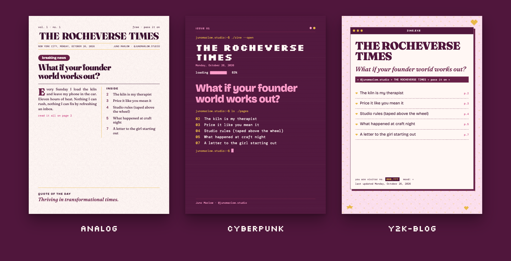
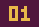
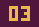
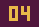
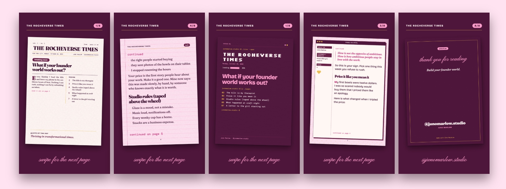
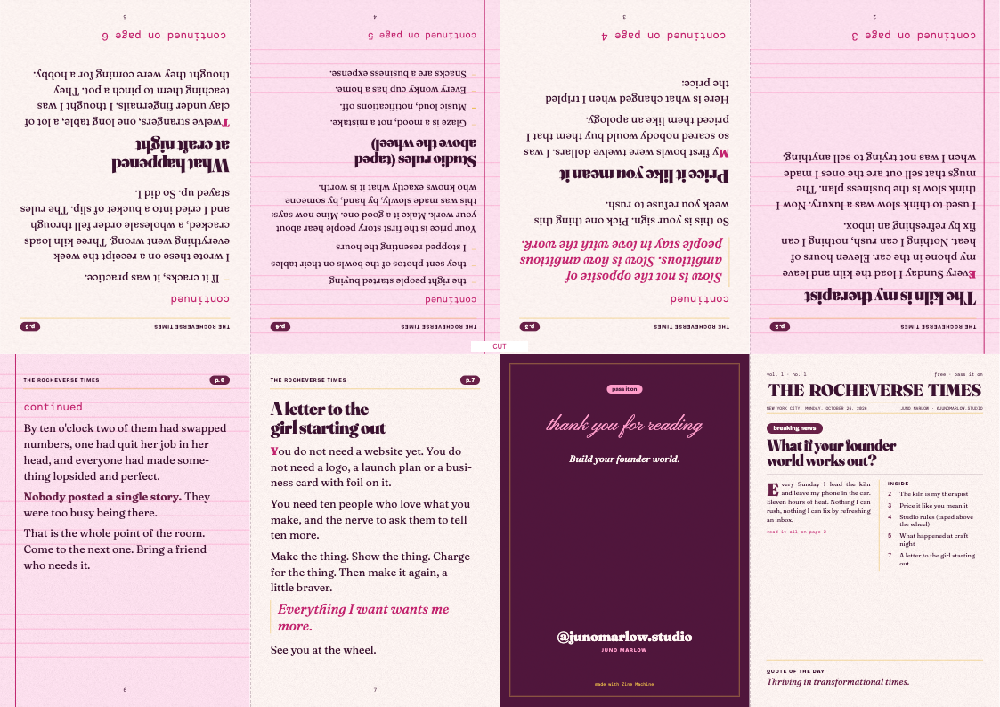

# Zine Machine

**Rocha Coded.** *Free tools from the Rocheverse.*

Paste five posts or voice notes. Get a mini zine you can print on one sheet, fold, and hand to someone.

<p align="center"></p>

Three looks from the same words: paper you could hold, a girly terminal, or a 2003 blog page. You choose.

<p align="center"></p>

## Start here
Five steps, about ten minutes the first time. You need a Mac (or a Linux computer), Google Chrome, and Claude Code.
On Claude Cowork instead? Skip to [Claude Cowork](#claude-cowork) below. It has its own short path.

1.  **Open Terminal.** Terminal is the app where you type instructions to your computer. On a Mac, press Command and
   Space, type `Terminal`, and press Return. You will see a small window with a line of text and a blinking cursor.
2.  **Check you have Python.** Python is the free language this tool is written in. Type this and press Return:
   ```sh
   python3 --version
   ```
   You will see something like `Python 3.12.8`. Any number from 3.10 up is perfect.
3.  **Copy Zine Machine onto your computer.** This "clones" it: makes your own copy from GitHub, the site where the
   tool lives, into the folder where Claude Code looks for skills.
   ```sh
   git clone https://github.com/RochaStone/zine-machine ~/.claude/skills/zine-machine
   ```
   You will see `Cloning into ...` and then the blinking cursor again.
4.  **Check it can make PDFs.** This looks for Python and a browser to print the pages with.
   ```sh
   python3 ~/.claude/skills/zine-machine/zine.py check
   ```
   You will see two lines that both say `ok`. That means you're ready.
5.  **Ask for your zine.** Type `claude` and press Return to open Claude Code, then say:
   "make a zine from my last five posts". You will see it ask which posts you'd like, one question at a time.

<p align="center"></p>

## What you get
- **A zine on one sheet of paper.** Print it, cut one line, fold it. Eight little pages, in the right order, every time.
- **Three looks, one zine.** Analog paper, a cyberpunk terminal, or a y2k blog window with a guestbook and a hit counter.
- **A cover with attitude.** A newspaper front page ("BREAKING NEWS", dateline, two columns) or a magazine cover with a big serif masthead and a script line running up the side.
- **Cream newsprint and blush lined paper, in plum ink.** Big serif headlines, gold hairlines, one script flourish. Editorial and certain.
- **The same zine for screens.** An eight page PDF to email or DM, and eight Instagram stories, one per page.
- **Your words, exactly as you wrote them.** It never rewrites a sentence. If there is too much, it asks which whole sentences to keep.

Make one as a lead magnet. A retreat handout. The thing on every chair at your workshop. The thing you leave in a cafe.

<p align="center"></p>

<p align="center"></p>

## Install
It runs on your own computer: a Mac or Linux with Python 3.10+ and Google Chrome (or Chromium, Edge or Brave).
No accounts, no servers, nothing to sign up for.

| Where you use it | Install it | Start it |
|---|---|---|
| [Claude Code](#claude-code) (recommended) | clone into `~/.claude/skills` | ask for a zine, or `/zine-machine` |
| [Claude Cowork](#claude-cowork) | upload `zine-machine.zip` as a skill | ask for a zine in a Cowork task |

A zip is one file that holds a whole folder, packed up so it's easy to download and upload.

Tested on macOS with Chrome, both through Playwright and by calling Chrome directly. Linux and the Cowork sandbox
run the same steps but have not been tested yet.

### Claude Code
```sh
git clone https://github.com/RochaStone/zine-machine ~/.claude/skills/zine-machine
python3 ~/.claude/skills/zine-machine/zine.py check
```
Then start Claude Code and say "make a zine from my last five posts". To get the newest version later, type
`git -C ~/.claude/skills/zine-machine pull`.

### Claude Cowork
Cowork (the Claude desktop app) runs tasks in a Linux sandbox on your computer that can only reach the folders you
give it.
1. Download `zine-machine.zip` from the [latest release](https://github.com/RochaStone/zine-machine/releases/latest).
2. In the Claude desktop app: Customize > Skills, then + > Create skill > Upload a skill, and pick the zip.
3. In Settings > Capabilities, turn on code execution and file creation.
4. Make a folder for your zine, put your posts in it (or have your Substack links ready), start a Cowork task, give
   it access to that folder, and ask: "Use Zine Machine to make a zine from these posts."
5. The sandbox may not have a browser. The skill installs one if it can (`pip install playwright`, then
   `python3 -m playwright install chromium`, a few minutes, once). If it can't, you still get the finished pages as
   HTML in your folder: open `zine-print.html` in Chrome, Print, Save as PDF, Landscape, Margins none, Background
   graphics on.

If the sandbox can't install software or reach the internet on your setup, use Claude Code instead.

<p align="center"></p>

## Make a zine
1. Give it your words. Any of these, up to eight posts:
   - markdown or `.txt` files (voice note transcripts are perfect), or a folder of them. Markdown is plain text
     with a `#` in front of a title.
   - one markdown file with `---` on its own line between posts
   - links to public Substack posts
   - or paste them straight into the chat
2. It asks for the zine's name, the cover style, your name and handle, and anything optional (a cover line, the
   scrawl, a line for the back, your colours).
3. It builds everything into `out/`:

| File | What it is |
|---|---|
| `zine-print.pdf` | one A4 landscape sheet, pages already in fold order |
| `zine-screen.pdf` | the eight pages in reading order, A5, for sending |
| `stories/page-01.png` to `page-08.png` | 1080 x 1920 Instagram stories |
| `preview.png` | your cover next to the folding sheet, for showing it off |
| `html/` | the source pages, to tweak a word and print from any browser |

4. Print, cut, fold. The steps are in [templates/FOLDING.md](templates/FOLDING.md).

<p align="center"></p>

Five short posts of 60 to 120 words each is the sweet spot. Short zines get bigger type. Long ones get slightly
smaller type. If it still doesn't fit, it tells you how many words are over and you choose what stays.

### By hand
```sh
python3 zine.py build my-posts/ --config zine.config.json --out out/
python3 zine.py build https://yourname.substack.com/p/a-post https://yourname.substack.com/p/another --config zine.config.json
python3 zine.py build my-posts/ --config zine.config.json --motif y2k-blog
```
`--motif` picks the look: `analog`, `cyberpunk` or `y2k-blog`. Your style file can set it too.
Copy [examples/zine.config.json](examples/zine.config.json) to start your config. `masthead` is `newspaper` or
`magazine`. `palette` takes hex colours for `hero` (the dark ground), `accent`, `paper`, `paper_pink`, `ink`, `marker`,
`plum`, `wine`, `gold` and `cool`.

`--renderer` picks how pages become PDFs: `auto` (Playwright if it is installed, else Chrome directly), `chrome`,
`playwright`, or `html` for no browser at all. If Chrome lives somewhere unusual, set `ZINE_CHROME` to its path.

## If it goes wrong (everyone's first time) 
This happens to everyone the first time. Here are the three most common things, and the fix for each.
- **"command not found: python3", or a version below 3.10.** Python isn't installed yet. Download it from
  [python.org/downloads](https://www.python.org/downloads/), open the installer, then try step 2 again.
- **"No PDFs this time".** Your computer has no browser the tool can print with. Your zine is still made, as web
  pages in `out/html/`. Open `zine-print.html` in Chrome or Safari, choose Print, then Save as PDF, Layout Landscape,
  Margins None, Background graphics on. Or install [Google Chrome](https://www.google.com/chrome/) and ask for the
  zine again.
- **"N words did not fit".** Your posts are longer than eight little pages can hold. Claude will show you which
  whole sentences to keep. Your words are never rewritten. Say yes, and it builds again.

If a Mac window asks to install "command line developer tools" when you clone, click Install, wait for it to finish,
and run the same line again.

<p align="center"></p>

## Make it yours
One `style.json` holds your colours, fonts, cover style and the lines you say a lot. Put it in your zine folder, or in `~/.rocha-coded/` to use it everywhere. Your Claude can make it with you from a few references.
Two examples ship with it: [examples/style.rocha-coded.json](examples/style.rocha-coded.json) is Rocha's own look, and [style.example.json](style.example.json) is the blank one to fill in. [STYLE.md](STYLE.md) explains every key.
The same file works across every Rocha Coded tool, so you make your look once.
Your `motif` picks the structure (analog, cyberpunk or y2k-blog) and your `palette` and `fonts` pick the colour and type. Both are yours to curate.

## What's inside
- `SKILL.md`: the steps your Claude follows.
- `style.example.json` and `STYLE.md`: your look, in one file.
- `zine.py`: the one command. Python standard library only.
- `zinelib/`: reading posts (markdown, text, Substack pages), flowing words onto pages, the fold order, the pages
  themselves, your style file, and the browser that prints them.
- `templates/zine.css` and `templates/skins.css`: the three looks. Fonts come from Google Fonts with system fallbacks.
- `scripts/make-readme-images.py`: makes every image on this page from the example zine. See [docs/IMAGES.md](docs/IMAGES.md).
- `templates/FOLDING.md`: how to cut and fold.
- `examples/`: five posts by a made-up potter, Rocha's style file, and the zine they make in both cover styles.
- `tests/`: the page flow and fold order tests, plus a full build. See [tests/TESTING.md](tests/TESTING.md).

## Licence
MIT. Copyright (c) 2026 Rochelle Livingstone / Thriving Era Studio. See [LICENSE](LICENSE).

 Sign my guestbook: tell me what you made at [github.com/RochaStone/zine-machine/issues](https://github.com/RochaStone/zine-machine/issues).

## Made by Rocha

Rocha \
Brand Alchemist & AI Architect \
Author of *Brand Alchemy in the Thriving Era* \
Creator of [Conscious Founder Operating System](https://founders.thrivingera.com) \
Founder, [Thriving Era Studio](https://thrivingera.com)

I help female founders build their founder world, and I build what they need next. \
Start with the audit: [thrivingera.com/audit](https://thrivingera.com/audit). \
Or book an exploratory call: [calendly.com/rochelle-thrivingera/exploratory-call](https://calendly.com/rochelle-thrivingera/exploratory-call). It is where we decide if we work together.

[Instagram @rocheverse](https://instagram.com/rocheverse) · [Substack](https://rochastone.substack.com) · [LinkedIn](https://www.linkedin.com/in/rochellelivingstonecosmic) · [More free tools](https://thrivingera.com/free) · [All tools on GitHub](https://github.com/RochaStone)
